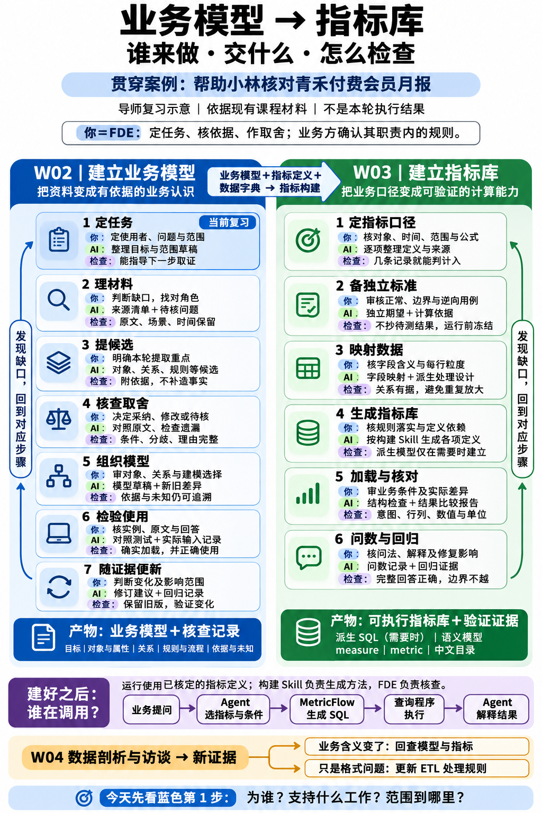

# 业务建模工具包

帮助 FDE 和 AI 从客户资料生成针对性的**业务模型实施方案**，再按依据建立、检查和维护业务模型。

**v0.2.1**：知识底座＋深入方法、AI 学习路线、访谈与两页 Checkpoint、实施方案和模型模板、验证与版本方法、两个虚构完整示范，以及可选的本地登记工具。

## 怎么开始

人的入口：[START-HERE.md](START-HERE.md)。执行 AI 的入口：[AGENTS.md](AGENTS.md)。

**还不熟悉资料要求？** 直接把手头原件交给 AI，说“按工具包先整理材料，再准备访谈”。AI 负责分类、摘要、保留依据、检查缺口，交付业务现状摘要、资料与缺口记录、两页现场访谈单。你不必先懂建模术语或填完表格。具体要求见 [05 资料整理入口](05-项目启动与定制.md)。

**已有资料，准备生成建模方案：**

> 读取本工具包的 AGENTS.md，结合我提供的客户资料生成本项目的业务模型实施方案。先明确目的、材料、完成标准、每步知识和产物；已有信息自行整理，缺口及执行状态据实记录。

已知资料和项目位置时一并给出；已有项目就让 AI 从接续记录继续。完整开工与接续用法见 [05](05-项目启动与定制.md)，先看[设备维修方案示范](examples/设备维修-实施方案示范.md)可了解成果长什么样。

## 获取与本地辅助

```bash
git clone https://github.com/as569951728/business-modeling-kit.git
```

也可使用 GitHub 的 **Code → Download ZIP**。阅读和使用提示词无需安装依赖；可选辅助命令需要 Python 3.9+，只使用标准库，由 AI 代为调用即可。

```bash
python3 kit.py init ../客户项目 --task '解释本次业务任务' --materials ../客户资料
python3 kit.py status ../客户项目
python3 kit.py check --project ../客户项目
```

首次默认只准备方案；`--mode learn` 用于陪学，`--mode execute` 表示本项目计划进入实施，仍以用户实际任务范围为准。工具本身不会调用 AI 或执行客户操作。重复初始化保留已有文件和状态。

## 内容导航

| 需要什么 | 入口 |
| --- | --- |
| 模型含义与判断方法 | [01 知识底座](01-建模知识底座.md)，以及 E1–E4 深入知识卡 |
| 谁来做、AI 先学什么、做到什么程度 | [08 实施方案与学习路线](08-实施方案与学习路线.md) |
| 如何访谈与收材料 | [02 访谈技巧](02-客户访谈技巧.md)、[03 Checkpoint](03-现场Checkpoint.md)、[两页打印版](assets/客户现场Checkpoint.pdf) |
| 怎样吩咐 AI、检查成果 | [04 工作手册](04-业务模型建立手册.md)、[06 检查测试与版本](06-检查测试与版本.md) |
| 本项目怎么启动和接续 | [05 项目启动](05-项目启动与定制.md) |
| 成果模板 | [项目背景](templates/项目背景.md)、[实施方案](templates/实施方案.md)、[业务模型](templates/业务模型.md)、[建模记录](templates/建模记录.md) |
| 完整示范 | [器材借用：材料到模型](examples/器材借用-完整示范.md)、[设备维修：材料到实施方案](examples/设备维修-实施方案示范.md) |
| 后续指标库 | [07 指标库衔接](07-指标库衔接.md)，当前只提供输入与边界约定 |

通用方法保存在本仓库；各客户的背景、原件、模型和运行证据存各自项目。示范是教学假设，不能复制为客户事实。

## 流程全景：课程复习示意



图由用户提供，采用青禾课程案例。图中的周次、“当前复习”和具体执行架构属于原课程语境；右侧指标库是本工具包后续扩展方向，不表示当前已实现。通用项目按自己的资料、任务和技术条件设计。

## 验证与维护

结构检查：`python3 kit.py check`；辅助工具测试：`python3 -m unittest discover -s tests -v`。这些检查不自动判断业务含义、本人采用或 Agent 使用效果。

本轮发现的问题、修订和实际检查范围见[复查记录](reviews/v0.2.1-资料整理入口复查.md)。来源与版本见 [SOURCES.md](SOURCES.md)。
