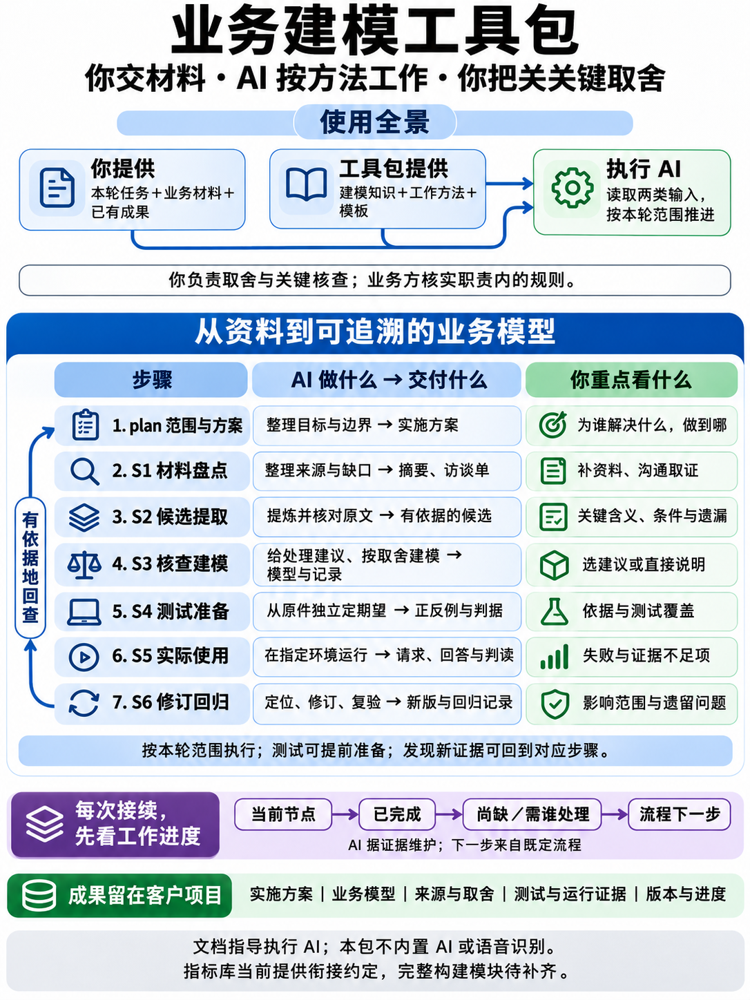

# 业务建模工具包

你提供业务材料，AI 按方法整理访谈、建立业务模型、构建并验证指标库；你把关关键取舍。成果包括 **实施方案、业务模型、指标定义与库、测试和验收证据、工作进度**。

本包提供方法和模板，实际构建与测试由 AI 使用客户项目的工具和环境完成。

**学习与交付路线：业务模型 → 指标库 → 数据清洗与 Demo。** 数据问题按实际依赖回流；ETL 通过交接衔接已有工具，不重复维护一套清洗方法。

**先看主线：** [指标库六步与人机分工图](assets/指标库-主线与人机分工.png)。看清节点、产物和关键判断后，让 AI 按手册落实细节。

## 开始使用

下载或克隆本仓库。第一次把**工具包位置、客户项目或材料位置，以及想解决的业务问题**交给 AI，让它读取本包 [AGENTS.md](AGENTS.md)。已有信息不必重复提供；原件不用先分类，表格不用你先填。

**首次开工：** [业务模型／指标库两份话术与 AI 学习路线](docs/快速开始.md)。AI 自行读本模块知识及当前节点方法，结合客户资料执行；你不用选择知识卡。

日常使用三个入口：

| 你说 | AI 应做 |
| --- | --- |
| **按工具包建立这个项目的业务模型／指标库。** | 选择本轮模块，读取相应知识、盘点材料，按已明确范围实施和检查 |
| **继续这个项目。** | 从已保存的进度和证据接着做，不重新问一遍背景 |
| **按工具包组织测试验收。** | 核标准、测试和回归，交一页结论与证据包，签署状态如实记录 |

每次先看四行：**当前节点／已完成／尚缺或需你处理／流程下一步**。AI 维护一个项目入口，详细材料从那里打开；涉及取舍先给建议，你可以选，也可以直接打字说明。你无需记章节编号或配置语法。[第一次使用与接续](docs/快速开始.md)。

<details>
<summary>查详细方法：访谈、业务模型、指标库与验收</summary>

| 你现在要做什么 | 从这里进入 |
| --- | --- |
| 整理手头资料，准备访谈 | [项目启动](docs/项目协作/05-项目启动与定制.md) → [访谈准备](docs/访谈/09-访谈准备与交接.md) |
| 整理访谈记录，提炼业务信息 | [沟通记录提炼](docs/访谈/10-沟通记录到业务信息.md) |
| 让 AI 建模，审核处理建议 | [业务模型建立手册](docs/建模/04-业务模型建立手册.md) |
| 让 AI 设计测试，检查模型与实际使用 | [测试方法与执行指令](docs/建模/06-检查测试与版本.md) |
| 验收模型，判断这一轮是否达标 | [验收与完成判定](docs/建模/12-业务模型验收与完成判定.md) |
| 让 AI 建立指标库 | [指标库建立手册](docs/指标库/13-指标库建立手册.md) |
| 让 AI 写测试、expected、judge 并排错 | [指标测试与证据排查](docs/指标库/14-测试判定与证据排查.md) |
| 验收指标库，接续数据清洗 | [指标验收与 ETL 交接](docs/指标库/15-验收与ETL交接.md) |
| 按工具包组织测试验收 | AI 按项目对象接续；指标库见 [完整组织流程](docs/指标库/15-验收与ETL交接.md) |
| 留存业务签署的验收依据 | [证据包与签署归档](docs/项目协作/16-验收证据留存与签署.md) |
| 看进度、继续上次的工作 | [工作进度与接续](docs/项目协作/11-工作进度与接续.md) |

</details>

**查全部方法：** [文档目录](docs/README.md) · **找成果格式：** [模板](templates/README.md) · **先看成品：** [虚构示例](examples/README.md)

<details>
<summary>目录与可选辅助工具</summary>

```text
docs/        使用方法、建模知识和维护说明
templates/   AI 填写的成果模板
examples/    虚构材料与完整示范
assets/      两页现场清单、工具包使用全景图
tests/       辅助工具测试
AGENTS.md    执行 AI 的入口
kit.py       本地项目登记与进度工具
```

文档可直接交给 AI 使用；指标库模块包含知识、构建、测试、排查、验收方法和完整虚构示范，执行 AI 按客户环境实现与验证。可选 `kit.py`（Python 3.9+）仍只管理业务模型进度；指标 M0–M6 由 AI 维护[专用进度表](templates/指标库实施与进度.md)。本包不内置 AI、语音识别或指标查询引擎，不以文档齐全宣称客户测试通过。

</details>

<details>
<summary>展开：业务模型模块流程图（plan／S1–S6）</summary>



此图保留业务模型模块的分工；指标库阶段见 13 的 M0–M6，不将旧图当全部模块全景。成果与实际证据保存在客户项目。

</details>

v0.8.2 · [升级与旧路径对照](docs/维护/升级与路径对照.md) · [来源与版本](docs/维护/SOURCES.md) · [本版复查](docs/维护/reviews/v0.8.2-双模块开工与知识读取复查.md)
